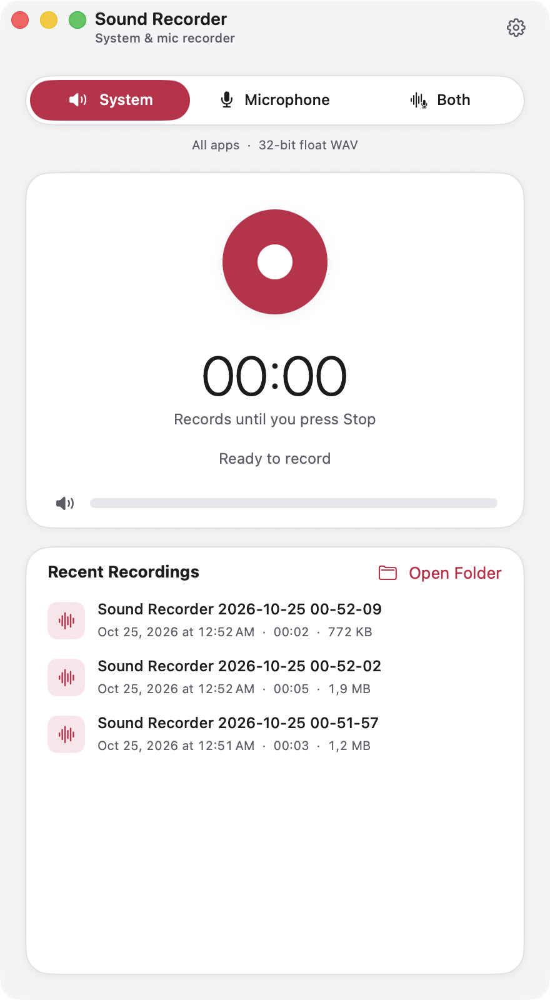
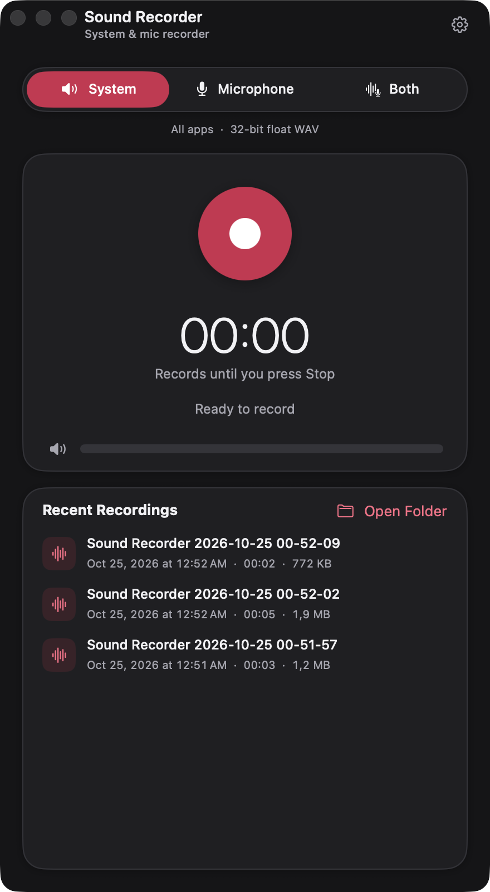
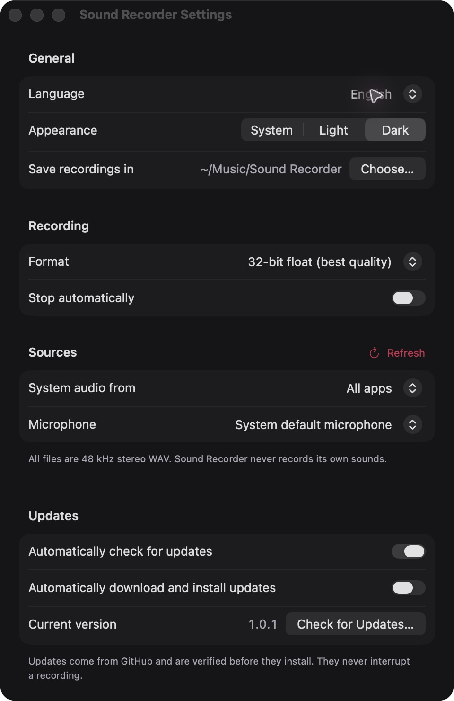

# Sound Recorder

A small native macOS app (SwiftUI, macOS 15+, Apple Silicon) that records system audio, a microphone, or
both mixed, to WAV with ScreenCaptureKit. No virtual audio driver needed. English and Vietnamese UI with an
in-app switch, remembered System / Light / Dark appearance, automatic updates, and a `sysaudio-record` CLI
built on the same capture engine.

| Light | Dark | Settings |
|---|---|---|
|  |  |  |

More: [minimum size, Vietnamese](docs/screenshots/light-minimum-vi.png) ·
[minimum size, dark](docs/screenshots/dark-minimum.png) · [Settings, Vietnamese](docs/screenshots/settings-light-vi.png)

## Install

1. Download `SoundRecorder-<version>.zip` from [Releases](https://github.com/BillyND/sound-recorder/releases/latest),
   unzip it and move **Sound Recorder.app** to `/Applications` (or `~/Applications`).
2. The app is signed with a self-signed certificate, not notarized by Apple, so Gatekeeper blocks the first
   launch. Right-click the app → **Open** → **Open**, or run:

   ```sh
   xattr -dr com.apple.quarantine "/Applications/Sound Recorder.app"
   ```

### Permissions on first run

- **Screen & System Audio Recording** (System Settings → Privacy & Security): needed for every source,
  even microphone-only, because capture goes through ScreenCaptureKit.
- **Microphone**: needed for the Microphone and Both sources.

The app shows a notice with a button to the right settings pane when one is missing. Updates keep the same
code signature, so macOS keeps these permissions across versions.

## Output

48 kHz stereo WAV, straight from ScreenCaptureKit with no resampling or processing. Formats: 32-bit float
(default, keeps headroom), 24-bit or 16-bit PCM (samples above full scale are clipped and counted).
Files go to `~/Music/Sound Recorder/` as `Sound Recorder 2026-10-24 23-30-05.wav`; the folder, format,
source, microphone, language and an optional "stop after" duration are remembered.

## Appearance

**Settings → General → Appearance** offers **System** (the default), **Light**, and **Dark**.
The choice applies immediately to every app window and is remembered across launches. System follows
the Mac's appearance. The interface uses opaque surfaces rather than glass or blurred materials;
colours and short transition curves live in `Sources/App/Style/Theme.swift`. Reduce Motion disables
non-essential transitions and the recording pulse. Timers and level meters update independently of
the rest of the window, and nothing animates while idle.

Local smoke measurements on the same Mac, 15 one-second `ps` samples per condition:

| Build | Idle CPU | Recording CPU | Idle RSS | Recording RSS |
|---|---:|---:|---:|---:|
| 1.0.0 | 0.04% | 5.35% | 97.9 MiB | 93.1 MiB |
| 1.0.1 | 0.05% | 6.63% | 112.7 MiB | 119.2 MiB |

These are short observations, not a controlled benchmark: the new app had exercised theme and Settings
changes, and other desktop apps were running. They do not establish a performance improvement.
The 1.0.1 system-recording smoke produced a finalized 40.46-second, 48 kHz stereo Float32 WAV.

## Updates

Sound Recorder checks this repo's GitHub releases with [Sparkle](https://sparkle-project.org). In
**Settings → Updates** you can turn off **Automatically check for updates** and **Automatically download
and install updates** (both on by default), see the current version and use **Check for Updates…**, which is
also in the app menu. Every update is verified against the app's EdDSA key and code signature before it
installs. An update never interrupts a recording: it waits until you press Stop.

## CLI

```sh
sysaudio-record out.wav [--duration SECONDS] [--app BUNDLE_ID] [--source system|mic|both] [--format 16|24|f32]
```

Defaults: all system audio, 16-bit PCM, until Ctrl-C. `--app` records one app and its helper processes.
The terminal app running it needs the same permissions.

## Build from source

Needs only the Xcode Command Line Tools. The first build downloads Sparkle (checksum-pinned) into
`packaging/sparkle-tools/`.

```sh
make install       # builds, signs and installs ~/Applications/Sound Recorder.app
make install-cli   # builds and installs ~/.local/bin/sysaudio-record
```

Builds are signed with the stable identity `Que Huong Studio Signing` when it is in the keychain (override
with `make install IDENTITY=...`), so permissions survive rebuilds. Without it the build is ad-hoc signed:
it runs, but permissions must be granted again after each build and published updates will not install over it.

Layout: `Sources/Engine` (capture engine shared by app and CLI), `Sources/CLI`, `Sources/App` (`Model/`,
`Main/` window views, `Settings/`, `Style/` theme and shared modifiers, `AppUpdater.swift`), `Resources/`
(Info.plist and `en`/`vi` strings), `packaging/` (signing and release scripts).

## Release (maintainers)

1. Bump `VERSION` (e.g. `1.0.1`), commit and push to `main`.
2. `make release` (optional notes: `NOTES="- Fixed …" make release`).

`packaging/release.sh` refuses a version that is not newer than the latest release or is already released,
builds with the stable signing identity, zips the app, signs the zip with the Sparkle EdDSA private key
from the login keychain (account `sound-recorder`), writes `appcast.xml` and creates the GitHub release with
both files. Installed apps pick it up from `releases/latest/download/appcast.xml`. The private key never
leaves the keychain; only the public key is in `Resources/Info.plist`.

## Tiếng Việt

Sound Recorder là ứng dụng macOS ghi âm thanh hệ thống, micro hoặc cả hai ra tệp WAV, có giao diện tiếng
Việt (đổi ngôn ngữ ngay trong Cài đặt).

- **Cài đặt:** tải `SoundRecorder-<phiên bản>.zip` ở mục [Releases](https://github.com/BillyND/sound-recorder/releases/latest),
  giải nén và kéo **Sound Recorder.app** vào thư mục Applications. Ứng dụng chưa được Apple công chứng nên
  lần đầu hãy bấm chuột phải → **Mở**, hoặc chạy lệnh `xattr -dr com.apple.quarantine "/Applications/Sound Recorder.app"`.
- **Quyền:** bật Sound Recorder trong Cài đặt hệ thống → Quyền riêng tư & Bảo mật → **Ghi màn hình & âm
  thanh hệ thống** (cần cho mọi nguồn, kể cả chỉ ghi micro) và **Micro** (khi ghi micro).
- **Giao diện:** Cài đặt → Chung → Giao diện có **Theo hệ thống**, **Sáng**, **Tối**; đổi ngay và nhớ lựa
  chọn khi mở lại. Nền đặc, không kính mờ; tôn trọng cài đặt Giảm chuyển động của macOS.
- **Cập nhật:** ứng dụng tự kiểm tra, tải và cài bản mới từ GitHub; có thể tắt trong Cài đặt → Cập nhật hoặc
  bấm **Kiểm tra cập nhật…**. Bản cập nhật không bao giờ làm gián đoạn khi đang ghi âm.
